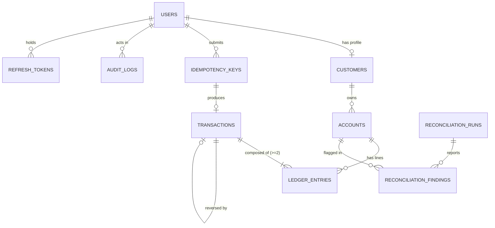
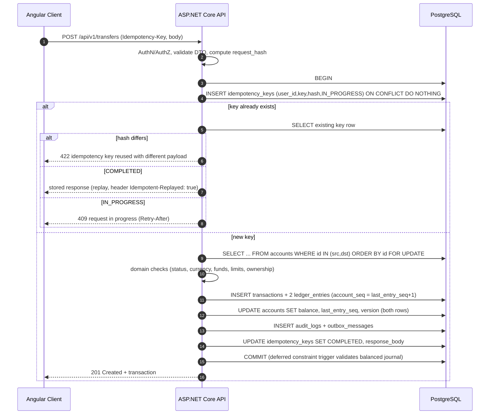

# Core Banking & Transaction Management System: PLAN.md

> **Status:** Planning (no code yet) · **Last updated:** 2026-11-06
> **Purpose:** A portfolio-grade, simplified core banking platform whose main goal is to *demonstrate financial-transaction integrity* (ACID, double-entry accounting, idempotency, concurrency safety, auditability) behind a clean REST API and a polished Angular client.

---

## Table of Contents

1. [Vision, Goals & Non-Goals](#1-vision-goals--non-goals)
2. [Personas, Roles & Permissions](#2-personas-roles--permissions)
3. [Scope: MVP, Should-Have, Stretch](#3-scope-mvp-should-have-stretch)
4. [Functional Requirements & Business Rules](#4-functional-requirements--business-rules)
5. [Accounting & Domain Model](#5-accounting--domain-model)
6. [Database Design (PostgreSQL 18)](#6-database-design-postgresql-18)
7. [Transaction Processing Design](#7-transaction-processing-design)
8. [Backend Architecture (.NET 10)](#8-backend-architecture-net-10)
9. [API Design](#9-api-design)
10. [Security Plan](#10-security-plan)
11. [Audit & Compliance Design](#11-audit--compliance-design)
12. [Frontend Plan (Angular 22)](#12-frontend-plan-angular-22)
13. [Observability](#13-observability)
14. [Testing Strategy](#14-testing-strategy)
15. [DevOps, Docker & CI/CD](#15-devops-docker--cicd)
16. [Repository Structure & Conventions](#16-repository-structure--conventions)
17. [Roadmap & Milestones](#17-roadmap--milestones)
18. [Documentation & Demo Deliverables](#18-documentation--demo-deliverables)
19. [Risks & Mitigations](#19-risks--mitigations)
20. [Architecture Decision Records (ADRs) to Write](#20-architecture-decision-records-adrs-to-write)
21. [Open Decisions](#21-open-decisions)
22. [Interview Talking Points](#22-interview-talking-points)
23. [Appendix](#23-appendix)

---

## 1. Vision, Goals & Non-Goals

### 1.1 Vision
A small but *correct* core banking system. Customers register, open savings/current accounts, deposit, withdraw and transfer money. Every movement of money is recorded in an immutable double-entry ledger, executed atomically, safe under concurrency, safe against client retries, and fully auditable.

### 1.2 Goals
| # | Goal | How it is proven |
|---|------|------------------|
| G1 | Money is never created or destroyed | Debits = credits enforced by DB constraint + reconciliation job + property-based tests |
| G2 | No lost updates / double spends | Row locking with deterministic lock order + concurrency tests (hundreds of parallel transfers) |
| G3 | Retries are safe | `Idempotency-Key` handling with request-fingerprint check + replay tests |
| G4 | Everything is traceable | Append-only audit log + immutable ledger + correlation IDs |
| G5 | Secure by default | ASP.NET Core Identity, JWT + refresh rotation, RBAC + resource-based authorization, rate limiting, OWASP-aligned |
| G6 | Production-like engineering | Docker, CI/CD, migrations, observability, tests, ADRs, docs |
| G7 | Pleasant UX | Responsive Angular 22 app with customer and admin experiences |

### 1.3 Non-Goals (state these explicitly in the README)
- No real payment rails (cards, SWIFT, local instant-payment networks, mobile wallets).
- No real KYC/AML integration (simulated status flow only).
- No multi-bank / inter-bank clearing; transfers are **intra-bank** only.
- No regulatory certification (PCI-DSS, etc.). The design only *borrows* good practices.
- No microservices. A **modular monolith** is the deliberate choice (see ADR-001).

### 1.4 What an employer can evaluate → where it lives in this plan
| Employer criterion | Evidence in the project |
|---|---|
| REST API architecture | §9: versioned resources, ProblemDetails, cursor pagination, OpenAPI, idempotency header |
| Relational DB design | §6: normalized schema, constraints, indexes, partitioning option, triggers, ERD |
| ACID transactions | §7: single-DB-transaction posting, isolation + locking strategy, ADR |
| Data consistency | §6/§7: CHECK constraints, deferred constraint trigger, reconciliation jobs |
| AuthN / AuthZ | §10: Identity, JWT, refresh rotation, policies, resource ownership checks |
| Financial integrity | §5/§7: double-entry, immutability, reversals instead of edits, idempotency |
| Engineering maturity | §13-§18: observability, tests (Testcontainers), CI/CD, docs |

---

## 2. Personas, Roles & Permissions

### 2.1 Personas
- **Customer (retail):** wants to see balances, move money, view history. Self-service only.
- **Administrator (bank back-office):** manages customers/accounts, freezes accounts, posts on-behalf transactions, reverses mistakes, reviews audit logs and reconciliation.
- **Auditor (optional third role):** read-only access to ledger, audit logs, reports. Very cheap to add and a great demonstration of least privilege.
- **System (background jobs):** reconciliation, interest posting (stretch), outbox dispatch, token cleanup. Actor `system` in audit logs.

### 2.2 Permission matrix (RBAC + resource ownership)
| Capability | Customer | Admin | Auditor |
|---|:-:|:-:|:-:|
| Register / login / manage own profile | ✅ | ✅ | ✅ |
| Open account (for self) | ✅ | ✅ (on behalf) | ❌ |
| View own accounts, balances, history | ✅ (own only) | ✅ (any) | ✅ (any, read-only) |
| Deposit / withdraw | ✅ (simulated channel, own accounts) | ✅ (on behalf) | ❌ |
| Transfer from own account | ✅ | ✅ (on behalf, flagged) | ❌ |
| Freeze / unfreeze / close account | ❌ (can request close) | ✅ | ❌ |
| Suspend customer | ❌ | ✅ | ❌ |
| Reverse a transaction | ❌ | ✅ (reason required) | ❌ |
| View audit logs | ❌ | ✅ | ✅ |
| View trial balance / reconciliation | ❌ | ✅ | ✅ |
| Manage admins/roles | ❌ | ✅ (super-admin flag) | ❌ |

**Enforcement layers:** (1) role policy at the endpoint, (2) **resource-based check** in the application layer (`account.CustomerId == currentUser.CustomerId`) to prevent IDOR/BOLA, (3) DB-level least privilege for the runtime role (see §6.7).

---

## 3. Scope: MVP, Should-Have, Stretch

### 3.1 MVP (must ship, maps 1:1 to the brief)
1. Customer registration + login (+ email verification via dev mail catcher).
2. Customer profile + account management (open/close, list, details).
3. Savings and current account types with different rules.
4. Deposits and withdrawals.
5. Inter-account transfers (intra-bank).
6. Double-entry ledger (journal entries + lines), immutable.
7. Atomic DB transactions + concurrency safety.
8. Idempotency keys on all money-moving endpoints.
9. Account balance + transaction history (filter + cursor pagination).
10. RBAC (Customer / Admin) with resource ownership checks.
11. Audit logs for every financial and security-sensitive operation.
12. Dockerized stack, CI pipeline, automated tests, seeded demo data.

### 3.2 Should-have (strong differentiators; do these before any stretch)
- Transaction **reversal** (compensating entries) by admin.
- **Reconciliation job** + admin report (ledger sum vs stored balance; global debits = credits).
- Daily transfer/withdrawal **limits** and minimum balance rules.
- Rate limiting + account lockout + refresh-token rotation with reuse detection.
- **Outbox pattern** + email notifications (to Mailpit in dev).
- Account **statements** (CSV export).
- OpenTelemetry traces/metrics, structured logs, health checks.
- Admin dashboard (volume, counts, failed attempts, reconciliation status).

### 3.3 Stretch (pick 2-3; don't do all)
- MFA (TOTP) and **passkeys** (ASP.NET Core Identity supports passkeys in .NET 10).
- Maker-checker (four-eyes) approval for large admin postings.
- Interest accrual/posting job for savings accounts (monthly).
- Account holds / authorization holds (available vs ledger balance).
- Tamper-evident audit log (hash chain).
- PostgreSQL declarative **partitioning** for `ledger_entries` / `audit_logs` (by month).
- Real-time balance updates via SignalR.
- Multi-currency accounts with an FX rate table (transfers across currencies via FX internal accounts).
- PDF statements.
- k6 load test report and published benchmark numbers.
- Aspire-style local developer dashboard (OTLP viewer) or Grafana LGTM stack.

---

## 4. Functional Requirements & Business Rules

### 4.1 Identity & Customer Management
- **FR-1** Register with email + password + profile (full name, DOB, phone, address). Password policy: min 12 chars, breached-password check optional (k-anonymity API is not needed; keep local denylist).
- **FR-2** Email verification required before opening accounts.
- **FR-3** Customer status lifecycle: `PENDING_VERIFICATION → ACTIVE → SUSPENDED → CLOSED`. A simulated "KYC approved" step can be auto or admin-triggered.
- **FR-4** Login with lockout after N failures; refresh-token rotation; logout revokes refresh token.
- **FR-5** Admin can search/list customers, suspend/reactivate.

### 4.2 Accounts
- **FR-6** Account types:
  | Rule | Savings | Current |
  |---|---|---|
  | Overdraft | No | Yes (configurable limit, default 0) |
  | Minimum balance | Yes (configurable) | No |
  | Monthly withdrawal count cap | Yes (configurable) | No |
  | Interest | Yes (stretch) | No |
  | Monthly maintenance fee | No | Optional (stretch) |
- **FR-7** Account number: 13-digit, generated from a PostgreSQL sequence + Luhn-style check digit, unique, never reused.
- **FR-8** Account status: `ACTIVE`, `FROZEN` (no debits; credits optionally allowed, configurable), `CLOSED` (balance must be exactly zero, no pending holds).
- **FR-9** A customer may hold multiple accounts (cap e.g. 5).
- **FR-10** Default currency **BDT** (stored as ISO 4217 code on every account and ledger entry; MVP forbids cross-currency transfers).

### 4.3 Money Movement
- **FR-11 Deposit:** credit customer account, debit bank cash account. Amount > 0, max per-transaction limit.
- **FR-12 Withdrawal:** debit customer account, credit bank cash account. Must keep `balance + overdraft_limit - amount ≥ min_balance_rule`.
- **FR-13 Transfer:** debit source, credit destination, atomically. Source ≠ destination, same currency, both `ACTIVE` (or destination allowed when frozen per policy), sufficient funds, within daily limit.
- **FR-14** All three require an `Idempotency-Key` header. Missing → `400`.
- **FR-15** Each posted transaction has a human-friendly `reference` (e.g. `TXN-20261106-8F3K2Q`) and a UUIDv7 id.
- **FR-16 Reversal (admin):** creates a *new* transaction with opposite entries linked via `reverses_transaction_id`; a transaction can be reversed at most once; reversal may be rejected if it would overdraw the target (policy decision, documented).
- **FR-17** Money values are always `decimal` + currency; never `double`/`float`. API serializes amounts as **strings** (`"1500.0000"`) to avoid JS float issues, or integers in minor units (see §21).

### 4.4 Query & Reporting
- **FR-18** Balance endpoint returns `ledger_balance`, `available_balance`, `currency`, `as_of`.
- **FR-19** Transaction history: filter by date range, type, amount range, direction; **keyset (cursor) pagination** ordered by `(posted_at, id)` desc; CSV export.
- **FR-20** Admin: trial balance, reconciliation runs, audit log search (actor, entity, action, date range, correlation id).

### 4.5 Notifications (should-have)
- **FR-21** On posted transaction, email the customer (via outbox → background worker → SMTP/Mailpit).

---

## 5. Accounting & Domain Model

### 5.1 Chart of accounts (internal "general ledger" accounts)
Customer accounts are **liabilities** of the bank (the bank owes the customer). The bank also needs internal accounts to make every entry balance:

| Code | Name | Class | Normal side | Purpose |
|---|---|---|---|---|
| `1000` | Cash / Vault (Settlement) | Asset | Debit | Counterparty for deposits & withdrawals |
| `2000` | Customer Deposits (control) | Liability | Credit | Optional control account; sum of all customer accounts |
| `4000` | Fee Income | Income | Credit | Fees |
| `5000` | Interest Expense | Expense | Debit | Interest paid on savings (stretch) |
| `9000` | Suspense / Adjustments | Equity/Other | n/a | Admin adjustments & reconciliation fixes |

Customer accounts: class `Liability`, normal side `Credit`.

### 5.2 Posting examples (sign convention is documented once and used everywhere)
| Operation | Debit | Credit |
|---|---|---|
| Deposit 1,000 to A | Cash 1,000 | A 1,000 |
| Withdraw 400 from A | A 400 | Cash 400 |
| Transfer 200 A → B | A 200 | B 200 |
| Fee 10 on A | A 10 | Fee Income 10 |
| Reversal of the transfer | B 200 | A 200 |

**Balance of a liability account = Σ credits − Σ debits.** The stored `accounts.balance` is a *denormalized cache* of that value, kept in the same DB transaction as the entries.

### 5.3 Core domain concepts (DDD-lite)
- **Aggregate roots:** `Customer`, `Account`, `LedgerTransaction` (journal entry with ≥ 2 lines, immutable once posted).
- **Value objects:** `Money(amount, Currency)`, `AccountNumber`, `IdempotencyKey`, `TransactionReference`.
- **Domain services:** `PostingService` (builds balanced entries), `TransferPolicy` (limits & rules), `AccountNumberGenerator`.
- **Invariants enforced in code *and* in the DB** (belt and braces):
  1. Every `LedgerTransaction` has ≥ 2 entries; Σ debits = Σ credits per currency.
  2. Entry amounts are strictly positive; direction is explicit (`DEBIT`/`CREDIT`).
  3. Posted transactions and entries are never updated or deleted.
  4. Customer account balance never drops below `-overdraft_limit` (DB `CHECK`).
  5. Currency of every entry equals the currency of its account.

### 5.4 Money handling rules
- C# `decimal` + `Money` value object; arithmetic only through the VO (guards currency mismatch).
- DB: `numeric(19,4)`. Display rounding at the edge only. Rounding policy for interest: banker's rounding (`MidpointRounding.ToEven`) documented in an ADR.
- All timestamps `timestamptz` (UTC). Use `TimeProvider` abstraction in code for testability.

---

## 6. Database Design (PostgreSQL 18)

### 6.1 Conventions
- **snake_case** table/column names (EF Core via a naming-convention plugin; Identity tables renamed too: `users`, `roles`, `user_roles`, …).
- **UUIDv7 primary keys** (time-ordered → index-friendly). PostgreSQL 18 ships native `uuidv7()`; in .NET use `Guid.CreateVersion7()` so IDs can be generated client-side.
- `created_at`, `updated_at` on mutable tables; ledger/audit tables are append-only (no `updated_at`).
- Concurrency tokens: PostgreSQL `xmin` (Npgsql supports it natively) or an explicit `version bigint` on `accounts`.
- Enum-like columns as `text` + `CHECK` (or native enums); mapped to C# enums with string conversion for readability and easy migrations.

### 6.2 Tables (logical)
```
users, roles, user_roles, user_claims, ...      -- ASP.NET Core Identity (renamed)
refresh_tokens(id, user_id, token_hash, family_id, expires_at, revoked_at, replaced_by_id, created_by_ip, user_agent)

customers(id, user_id UNIQUE, customer_no UNIQUE, full_name, date_of_birth, phone, address jsonb,
          status, kyc_status, created_at, updated_at)

accounts(id, account_number UNIQUE, customer_id NULL FK, kind {CUSTOMER|INTERNAL},
         product_type {SAVINGS|CURRENT|CASH|FEE_INCOME|SUSPENSE|...},
         ledger_class {ASSET|LIABILITY|INCOME|EXPENSE|EQUITY}, currency char(3),
         status {ACTIVE|FROZEN|CLOSED}, balance numeric(19,4), held_amount numeric(19,4) DEFAULT 0,
         overdraft_limit numeric(19,4) DEFAULT 0, min_balance numeric(19,4) DEFAULT 0,
         daily_debit_limit numeric(19,4), last_entry_seq bigint DEFAULT 0,
         opened_at, closed_at, created_at, updated_at, version)

transactions(id, reference UNIQUE, type {DEPOSIT|WITHDRAWAL|TRANSFER|FEE|REVERSAL|ADJUSTMENT|INTEREST},
             status {POSTED}, amount numeric(19,4), currency char(3), description, channel,
             initiated_by_user_id, on_behalf_of_admin bool, idempotency_key_id NULL FK,
             reverses_transaction_id NULL UNIQUE FK, metadata jsonb, posted_at, value_date)

ledger_entries(id, transaction_id FK, account_id FK, direction {DEBIT|CREDIT},
               amount numeric(19,4) CHECK (amount > 0), currency char(3),
               account_seq bigint, balance_after numeric(19,4), posted_at,
               UNIQUE(account_id, account_seq))

idempotency_keys(id, user_id, key, endpoint, request_hash, status {IN_PROGRESS|COMPLETED},
                 response_status, response_body jsonb, transaction_id NULL, created_at, expires_at,
                 UNIQUE(user_id, key))

audit_logs(id, occurred_at, actor_user_id, actor_role, actor_ip, user_agent, correlation_id,
           action, entity_type, entity_id, outcome {SUCCESS|DENIED|FAILED},
           before jsonb, after jsonb, metadata jsonb, prev_hash, row_hash)

outbox_messages(id, type, payload jsonb, occurred_at, processed_at, attempts, last_error)

reconciliation_runs(id, started_at, finished_at, status, accounts_checked, discrepancies_found)
reconciliation_findings(id, run_id, account_id, expected_balance, actual_balance, severity, resolved_at)
```

### 6.3 ERD (conceptual)


### 6.4 Database-enforced integrity (the "wow" section for reviewers)
1. **Balanced journal:** a `DEFERRABLE INITIALLY DEFERRED` **constraint trigger** on `ledger_entries` verifies, at commit, that for each `transaction_id` Σ debits = Σ credits per currency and the line count ≥ 2.
2. **Immutability:** `BEFORE UPDATE OR DELETE` triggers on `ledger_entries`, `transactions`, `audit_logs` raise exceptions. Additionally the runtime DB role is granted only `INSERT, SELECT` on them.
3. **No overdraft beyond limit:** `CHECK (kind <> 'CUSTOMER' OR balance + overdraft_limit >= 0)`.
4. **Per-account sequence:** `UNIQUE(account_id, account_seq)` turns any lost-update bug into a loud constraint violation instead of silent corruption.
5. **One reversal per transaction:** `UNIQUE(reverses_transaction_id)`.
6. **Idempotency uniqueness:** `UNIQUE(user_id, key)`.
7. **Currency consistency:** composite FK or trigger ensuring entry currency equals account currency.

### 6.5 Indexing plan
- `ledger_entries(account_id, posted_at DESC, id DESC)`: powers history (keyset pagination).
- `ledger_entries(transaction_id)`.
- `transactions(posted_at DESC)`, `transactions(reference)`.
- `audit_logs(entity_type, entity_id, occurred_at DESC)`, `audit_logs(actor_user_id, occurred_at DESC)`, `audit_logs(correlation_id)`.
- `idempotency_keys(expires_at)` for cleanup.
- Partial index for outbox: `outbox_messages(occurred_at) WHERE processed_at IS NULL`.
- Verify with `EXPLAIN (ANALYZE, BUFFERS)` and record results in `docs/performance.md`.

### 6.6 Migrations & seeding
- EF Core migrations for tables; **raw SQL migrations** (inside EF migrations) for triggers, constraint triggers, sequences, grants.
- Migration applied by a dedicated **migrator** container/job (not by the API at startup in production).
- Seed: chart of accounts, roles, admin user (from env), demo customers/accounts/transactions (dev & demo profile only).

### 6.7 Database roles
- `bank_migrator`: owner, runs migrations.
- `bank_app`: runtime; limited grants (no `UPDATE/DELETE` on append-only tables, no DDL).
- `bank_readonly`: for reporting/Grafana (optional).

### 6.8 PostgreSQL 18 features worth using (verify availability at kickoff)
- Native `uuidv7()`; virtual generated columns (e.g., derived `available_balance`); improved `EXPLAIN` output; `RETURNING OLD/NEW` for audit-friendly updates; async I/O improvements (mention in perf notes).

---

## 7. Transaction Processing Design

### 7.1 Principles
- **One business operation = one database transaction** containing: idempotency record, balance locks, ledger entries, balance updates, audit record, outbox message.
- Ledger = **source of truth**; `accounts.balance` = fast cache that must always equal Σ entries (verified continuously).
- No external I/O (email, HTTP) inside the money transaction; use the **outbox**.

### 7.2 Transfer algorithm (authoritative sequence)


### 7.3 Concurrency strategy
- **Default:** `READ COMMITTED` + **pessimistic row locks** (`SELECT … FOR UPDATE`) on involved accounts, **always ordered by account id** → deadlock-free for two-account transfers.
- **Alternative to document in ADR:** `SERIALIZABLE` isolation with automatic retry on `40001` (serialization failure). Include a benchmark comparing both under contention (hot-account scenario).
- Optimistic concurrency token (`xmin`/`version`) stays as a **safety net** in EF Core; a `DbUpdateConcurrencyException` maps to a retry/`409`.
- Retry policy (Polly via `Microsoft.Extensions.Resilience`) *only* for transient DB errors/deadlocks, and only **around the whole unit of work**, never inside it.
- Daily-limit checks run **after** locking the source account so they see a consistent view.

### 7.4 Idempotency design (details)
- Header: `Idempotency-Key` (client-generated UUID, 16-64 chars). Scope: `(user_id, key)`.
- `request_hash` = SHA-256 of canonicalized method + route + body. Same key + different hash → `422`.
- States: `IN_PROGRESS` (inserted in the *same* transaction, so it rolls back if the operation fails) → `COMPLETED` (stores status code + response body).
- **Failure semantics:** business-rule rejections (e.g., insufficient funds) are *also* recorded and replayed (deterministic result) unless they are transient (5xx, deadlock), which roll back and allow retry. Document this choice.
- TTL: 24-72 h; cleanup job purges expired keys.
- Implemented as an **endpoint filter / middleware** so handlers stay clean. The Angular HTTP interceptor generates the key once per user action and reuses it on retry.
- Test matrix: replay, concurrent duplicates (two simultaneous requests, same key), same key different payload, expired key, failure-then-retry.

### 7.5 Deposits & withdrawals
Same skeleton as transfers with the internal **Cash account** as the counterparty. The Cash account row lock is a hot spot, so options to document: (a) per-channel/branch cash accounts (e.g., `1000-ONLINE`, `1000-BRANCH-01`), (b) accept it and measure. Plan: start with (a) using a small pool of cash accounts picked deterministically.

### 7.6 Reversals & corrections
- Never update/delete. Admin posts a `REVERSAL` transaction with opposite entries; both are linked and visible in history.
- Requires reason code + free text; recorded in audit; optional maker-checker (stretch).

### 7.7 Reconciliation (should-have)
- Nightly + on-demand job (`BackgroundService` or Quartz/Hangfire with PostgreSQL storage):
  1. For each account: recompute balance from entries and compare to `accounts.balance`.
  2. Global: Σ debits = Σ credits; Σ liabilities + equity = assets (trial balance).
  3. Verify per-account `account_seq` is gapless.
  4. Write `reconciliation_runs/findings`; emit metric + alert log if any discrepancy.
- Includes a *fault-injection test* that corrupts a balance in a test DB and proves the job detects it.

### 7.8 Interest & fees (stretch)
Monthly job posts interest (`INTEREST` transactions: Interest Expense → customer account), idempotent per `(account_id, period)` using a deterministic idempotency key.

---

## 8. Backend Architecture (.NET 10)

### 8.1 Style
**Modular monolith**, Clean Architecture layering, **vertical-slice feature folders** inside the Application layer. Single deployable API, single database, strict module boundaries enforced by architecture tests.

Modules: `Identity`, `Customers`, `Accounts`, `Ledger` (posting engine), `Payments` (deposit/withdraw/transfer orchestration), `Audit`, `Reporting`, `Notifications`.

### 8.2 Layers / projects
```
Bank.Domain          -> entities, value objects, domain services, domain events (no dependencies)
Bank.Application     -> use-cases (commands/queries), validators, ports (interfaces), policies
Bank.Infrastructure  -> EF Core, repositories, Identity, outbox, email, jobs, clock
Bank.Api             -> Minimal API endpoints, filters, auth, OpenAPI, composition root
Bank.Migrator        -> console app/job that applies migrations + seed
Bank.*.Tests         -> Unit, Integration (Testcontainers), Architecture, Concurrency
```

### 8.3 Technology choices (backend)
| Concern | Choice | Notes |
|---|---|---|
| Runtime | **.NET 10 (LTS), C# 14** | Use `TimeProvider`, `Guid.CreateVersion7()`, built-in validation for Minimal APIs |
| Web | **ASP.NET Core Minimal APIs** + endpoint groups | Organized per feature; controllers acceptable if preferred |
| ORM | **EF Core 10** + **Npgsql** provider | Snake-case naming convention plugin; raw SQL for locks/triggers |
| Hot-path SQL | EF `FromSql`/`ExecuteSql` or Dapper | For `SELECT … FOR UPDATE` and reporting queries |
| Auth | **ASP.NET Core Identity** (+ JWT bearer) | Refresh token rotation, lockout, optional TOTP/passkeys |
| Validation | **FluentValidation** (+ built-in minimal API validation for simple DTOs) | |
| Mapping | **Mapperly** (source generator) or manual | Avoid reflection mappers; AutoMapper/MediatR are now commercial, so prefer plain handler classes or a source-generated mediator |
| Handlers/CQRS-lite | Plain `ICommandHandler<T>/IQueryHandler<T>` + decorators (logging, validation, transaction) | Or a source-generated mediator library |
| API docs | Built-in `Microsoft.AspNetCore.OpenApi` + **Scalar** UI | OpenAPI doc also drives TS client generation |
| Versioning | `Asp.Versioning` (URL segment `/api/v1`) | |
| Errors | **ProblemDetails (RFC 9457)** + stable `error_code` | Global exception handler (`IExceptionHandler`) |
| Rate limiting | Built-in `Microsoft.AspNetCore.RateLimiting` | Strict on auth and money endpoints |
| Background work | `BackgroundService` + outbox; Quartz.NET or Hangfire (PostgreSQL) for scheduled jobs | |
| Caching | `HybridCache` only for non-financial reference data | **Never cache balances** |
| Logging | **Serilog** (structured) + enrichers (correlation id, user id) | |
| Telemetry | **OpenTelemetry** (traces, metrics, logs) → OTLP | |
| Email (dev) | **Mailpit** container | MailKit for SMTP |
| Resilience | `Microsoft.Extensions.Resilience` (Polly v8) | Transient DB faults only |
| Testing | **xUnit v3**, FluentAssertions-alternative (Shouldly/AwesomeAssertions), **Testcontainers**, **Respawn**, `WebApplicationFactory`, **FsCheck** (property tests), **NetArchTest** | |
| Static analysis | Roslyn analyzers, `TreatWarningsAsErrors`, `dotnet format`, SonarAnalyzer, CodeQL | |

> Library licensing and versions change quickly; confirm each one's current license/status when you start (this table is a *recommendation*, not a lock-in).

### 8.4 Cross-cutting pipeline (order matters)
`Exception handler → HTTPS/HSTS → Correlation ID → Serilog request logging → CORS → Rate limiter → AuthN → AuthZ → Idempotency filter (money endpoints) → Validation → Handler (UoW/transaction decorator) → Audit/Outbox in same transaction`.

### 8.5 Unit of Work & transactions in code
- A **transaction decorator** opens a DB transaction for commands; handlers never call `SaveChanges` partially.
- EF Core **SaveChanges interceptor** stamps `created_at/updated_at`, collects domain events → outbox rows, writes generic audit rows for non-financial entity changes.
- Financial audit rows are written **explicitly** by the posting handlers (richer semantic actions like `TRANSFER_POSTED`).

### 8.6 Domain events & outbox
Domain events (`TransactionPosted`, `AccountFrozen`, `CustomerRegistered`) → serialized into `outbox_messages` inside the same transaction → dispatcher polls using `FOR UPDATE SKIP LOCKED` (safe with multiple instances) → handlers send emails / update projections. At-least-once delivery; handlers are idempotent.

---

## 9. API Design

### 9.1 Conventions
- Base path `/api/v1`, JSON, `snake_case` or `camelCase` (**pick one, document, enforce**; recommendation: `camelCase` in JSON for the Angular client).
- Resource-oriented nouns; actions that aren't CRUD use sub-resources (`/accounts/{id}/freeze`).
- `Idempotency-Key` required on `POST /deposits|withdrawals|transfers|admin/transactions/*/reversal`.
- Responses: `201 + Location` on creates; `200/204`; errors as `application/problem+json` with `type`, `title`, `status`, `detail`, `error_code`, `trace_id`, field `errors`.
- **Cursor pagination** (`?limit=50&cursor=…`) with opaque base64 cursor of `(posted_at,id)`; list responses include `next_cursor`.
- Filtering/sorting whitelists; max page size enforced.
- `ETag`/`If-Match` on mutable resources (account settings) as optimistic concurrency demo (optional).
- `X-Correlation-Id` accepted/returned; `traceparent` honored.
- Money in JSON: string decimal (`"1250.5000"`) + `currency`.

### 9.2 Endpoint catalog (MVP + should-have)
| Area | Method & Path | Role | Notes |
|---|---|---|---|
| Auth | `POST /auth/register` | Public | Creates user + customer (pending verification) |
| | `POST /auth/verify-email` | Public | Token from email |
| | `POST /auth/login` | Public | Returns access token; refresh token in httpOnly cookie |
| | `POST /auth/refresh` | Public | Rotation + reuse detection |
| | `POST /auth/logout` | Auth | Revokes refresh family |
| | `POST /auth/forgot-password`, `/reset-password` | Public | |
| Me | `GET /me`, `PATCH /me` | Auth | Profile |
| Accounts | `POST /accounts` | Customer/Admin | Open savings/current |
| | `GET /accounts` | Customer (own) / Admin (filter) | |
| | `GET /accounts/{id}` | Owner/Admin/Auditor | |
| | `GET /accounts/{id}/balance` | Owner/Admin/Auditor | ledger + available |
| | `GET /accounts/{id}/transactions` | Owner/Admin/Auditor | Cursor pagination + filters |
| | `GET /accounts/{id}/statement?from&to&format=csv` | Owner/Admin | |
| | `POST /accounts/{id}/close` | Owner(request)/Admin | Balance must be 0 |
| Money | `POST /deposits` | Customer/Admin | Idempotent |
| | `POST /withdrawals` | Customer/Admin | Idempotent |
| | `POST /transfers` | Customer/Admin | Idempotent |
| | `GET /transactions/{id}` | Owner/Admin/Auditor | With entries |
| Admin | `GET /admin/customers`, `GET /admin/customers/{id}` | Admin/Auditor | Search |
| | `POST /admin/customers/{id}/suspend`, `/reactivate` | Admin | Audited |
| | `POST /admin/accounts/{id}/freeze`, `/unfreeze` | Admin | Audited |
| | `POST /admin/transactions/{id}/reversal` | Admin | Idempotent, reason |
| | `GET /admin/audit-logs` | Admin/Auditor | Filters |
| | `GET /admin/ledger/trial-balance` | Admin/Auditor | |
| | `POST/GET /admin/reconciliation/runs` | Admin/Auditor | |
| | `GET /admin/dashboard` | Admin | KPIs |
| Ops | `GET /health/live`, `/health/ready` | Internal | DB, migrations, outbox lag |

### 9.3 Error code catalog (examples)
`INSUFFICIENT_FUNDS`, `ACCOUNT_FROZEN`, `ACCOUNT_CLOSED`, `CURRENCY_MISMATCH`, `DAILY_LIMIT_EXCEEDED`, `SAME_ACCOUNT_TRANSFER`, `IDEMPOTENCY_KEY_REQUIRED`, `IDEMPOTENCY_KEY_REUSED`, `REQUEST_IN_PROGRESS`, `TRANSACTION_ALREADY_REVERSED`, `FORBIDDEN_RESOURCE`, `VALIDATION_FAILED`, `RATE_LIMITED`. Keep this in `docs/api/error-codes.md` and generate the Angular error-message map from it.

---

## 10. Security Plan

Reference frameworks: **OWASP ASVS (L2 target)**, OWASP API Security Top 10 (2023), OWASP Cheat Sheets.

| Area | Decision |
|---|---|
| Passwords | Identity hasher (PBKDF2 default) or Argon2id via custom hasher; min length 12; lockout (e.g., 5 tries / 15 min) |
| Access token | JWT, 10-15 min lifetime, asymmetric signing (ES256/RS256) with `kid` and key rotation plan; minimal claims (`sub`, roles, `customer_id`) |
| Refresh token | Opaque random 256-bit, **stored hashed**, rotated every use, family-based **reuse detection** (revoke entire family), httpOnly+Secure+SameSite=Strict cookie, path-scoped to `/api/v1/auth` |
| SPA token storage | Access token in memory only (never localStorage). Same-origin reverse proxy (nginx) removes CORS complexity. Alternative (BFF pattern) is documented as ADR |
| AuthZ | Role policies + **resource-based handlers** (`IAuthorizationHandler`) for account ownership; deny-by-default (`FallbackPolicy` requires auth) |
| BOLA/IDOR | Every account/transaction query is scoped by owner in the query itself (not just post-fetch checks); tests assert 404/403 for foreign IDs |
| Input | Validation on every DTO; reject unknown enums; max body size; decimal scale/precision validation; no mass assignment (separate request/response DTOs) |
| Rate limiting | Per-IP on auth endpoints, per-user on money endpoints, global concurrency limiter |
| Transport/headers | HTTPS + HSTS; CSP, `X-Content-Type-Options`, `Referrer-Policy`, `Permissions-Policy`, frame-ancestors none |
| Secrets | `.env`/Docker secrets/User Secrets; none in git; `gitleaks` in CI |
| Data protection | Hash/mask national ID fields (don't store raw unless needed); PII excluded from logs; DataProtection keys persisted for cookie/token protection |
| Supply chain | Dependabot/Renovate, `dotnet list package --vulnerable`, `npm audit`, CodeQL, Trivy image scan, SBOM (CycloneDX) |
| Abuse | Account enumeration-safe responses (register/forgot-password), generic login errors, anti-automation limits |
| Admin hardening | Admin creation via migrator/CLI only; admin actions always audited; optional TOTP/passkey required for admins (stretch) |
| Threat model | STRIDE table in `docs/security/threat-model.md` (spoofing, tampering of balances, repudiation → audit, info disclosure, DoS, elevation) |

---

## 11. Audit & Compliance Design

- **What is audited:** login success/failure, lockouts, password/MFA changes, account open/close/freeze, customer suspend, every deposit/withdrawal/transfer/reversal (including *denied/failed* attempts with reason), admin searches over PII (optional), role changes, reconciliation runs.
- **Record shape:** who (user, role, IP, UA), what (`action`, entity type/id), when (UTC), outcome, `correlation_id`, before/after JSON (sensitive fields masked), and link to ledger `transaction_id`.
- **Integrity:** append-only (trigger + grants). **Stretch:** hash chain `row_hash = SHA256(prev_hash || canonical_row)` plus a verification endpoint/job; periodically anchor the latest hash in a file/log to show tamper-evidence.
- **Atomicity:** audit row for a successful financial operation is written in the *same* DB transaction; audit rows for *denied/failed* attempts are written in a separate short transaction so they survive rollbacks.
- **Retention:** policy documented (e.g., 7 years for financial records; configurable); partition by month (stretch) to make archival cheap.
- **Ledger vs audit:** ledger = *what happened to money*; audit = *who did what and why*. Keep them distinct but cross-referenced.

---

## 12. Frontend Plan (Angular 22)

### 12.1 Principles
- **Standalone components only**, **signals-first** state, zoneless change detection, new control flow (`@if/@for/@switch`), `@defer` for heavy views, strict TypeScript, ESLint (angular-eslint) + Prettier.
- Feature-based folders under `src/app` with **`@/` path alias** (`tsconfig.json` `paths`).
- **Tailwind CSS v4** for styling + **Angular CDK** (a11y, overlays, a11y primitives) + a headless/accessible component approach (e.g., Spartan UI or Angular Aria; decide at kickoff). Dark mode support.
- Forms: Angular **Signal Forms** if stable in v22 for your use, otherwise typed Reactive Forms; client-side schema validation (e.g., Zod) can mirror server DTO rules, with the **server remaining the source of truth**.
- API client **generated from the OpenAPI document** (e.g., `@hey-api/openapi-ts`, `ng-openapi-gen` or NSwag) in CI, so contract drift breaks the build.
- Tests: **Vitest** (Angular's modern default test runner) for unit/component tests, **Playwright** for E2E.
- i18n-ready (Angular i18n or Transloco); BDT formatting via `Intl.NumberFormat`.

### 12.2 Architecture
```
src/app/
  core/        auth (token store, interceptors, guards), http (error mapping), layout shell, config
  shared/      ui primitives, pipes (money), directives, form controls, utils
  features/
    auth/          login, register, verify-email, forgot/reset password
    dashboard/     account cards, recent activity, quick actions
    accounts/      list, details, open-account wizard, statement export
    payments/      deposit, withdraw, transfer (with confirm step + idempotency)
    transactions/  history (filters, infinite scroll via cursor), detail with ledger lines
    profile/       profile, security (sessions, MFA)
    admin/         customers, accounts, audit-logs, reconciliation, dashboard, reversals
  app.routes.ts    lazy routes + role guards
```

### 12.3 Key UX/engineering details
- **Idempotency interceptor:** generates a UUID per *user action* (not per HTTP attempt), stores it in the form/store, reuses it on retry; "double-click safe" submit buttons.
- **Auth interceptor:** attaches access token; on `401` triggers a single-flight refresh then retries; on refresh failure → logout.
- **Error interceptor:** maps `error_code` → friendly localized messages; shows `trace_id` for support.
- **Money component/pipe:** one place for formatting; amounts handled as strings/decimal library, never float math.
- **Transfer UX:** account picker, beneficiary lookup by account number (masked confirmation), review & confirm screen, success receipt with reference, optimistic UI *avoided* for balances (refetch after success).
- **Role-aware navigation** (customer vs admin vs auditor) with route guards (UX only; server enforces security).
- **Admin console:** data tables with server-side filtering/cursor paging, audit-log viewer with diff display, reversal dialog with reason, reconciliation run viewer, KPI dashboard (charts via ngx-charts/Chart.js).
- Accessibility: WCAG 2.2 AA target; keyboard navigation; axe checks in Playwright.
- Performance: lazy routes, `@defer`, image/asset budgets, Lighthouse CI score tracked.

### 12.4 Hosting
Production build served by **nginx** container; `/api` reverse-proxied to the API (same origin → no CORS, cookie-friendly).

---

## 13. Observability

- **Logs:** Serilog JSON to stdout; enrichers: `trace_id`, `correlation_id`, `user_id` (hashed or id only), `account_id` where relevant; PII redaction.
- **Traces:** OpenTelemetry ASP.NET Core + EF Core/Npgsql + HttpClient instrumentation; custom spans around `PostTransfer` (lock wait, insert, commit).
- **Metrics (custom):** `transfers_posted_total`, `transfers_rejected_total{reason}`, `idempotent_replays_total`, `db_lock_wait_seconds`, `serialization_retries_total`, `outbox_lag_seconds`, `reconciliation_discrepancies`.
- **Health:** `/health/live` (process), `/health/ready` (DB reachable, migrations applied, outbox lag under threshold).
- **Dev stack:** OTLP receiver + viewer (Aspire Dashboard container, Seq, or Grafana LGTM) in `docker-compose.observability.yml` so screenshots/demos are easy.
- **Alerts (documented):** any reconciliation discrepancy, refresh-token reuse detection, spike in lock waits.

---

## 14. Testing Strategy

| Level | What | Tools |
|---|---|---|
| Unit (domain) | `Money`, posting rules, limits, state transitions, account number check digit | xUnit v3 |
| Property-based | For random sequences of operations: Σ balances conserved, no negative balances, debits = credits, replaying ledger reproduces balances | FsCheck |
| Integration | Real PostgreSQL 18 in a container; full HTTP pipeline; migrations applied; DB triggers verified (try to `UPDATE ledger_entries` → expect failure) | Testcontainers, `WebApplicationFactory`, Respawn |
| **Concurrency** | 200 parallel transfers across a small account set; opposite-direction transfers (deadlock check); same-key duplicate requests; hot-account contention; assert conservation + no overdraft + gapless `account_seq` | Custom harness with `Task.WhenAll` |
| Security | AuthZ matrix tests (every endpoint × role), IDOR tests, refresh-reuse test, rate-limit test, header checks | xUnit + integration host; OWASP ZAP baseline scan in CI |
| Architecture | Layer/module dependency rules | NetArchTest/ArchUnitNET |
| Contract | OpenAPI snapshot test (breaking-change detection); generated client compiles | oasdiff / Verify |
| Frontend unit | Components, services, interceptors, guards | Vitest + Testing Library |
| E2E | Register → verify → open account → deposit → transfer → history; admin freeze/reverse | Playwright (+ axe) |
| Performance | Transfer throughput/latency under contention; compare READ COMMITTED+locks vs SERIALIZABLE | k6 |
| Mutation (stretch) | Domain/posting code mutation score | Stryker.NET |
| Fault injection | Kill DB connection mid-transaction (Toxiproxy) → no partial postings, retries safe | Testcontainers + Toxiproxy |

**Quality gates:** coverage threshold on Domain/Application (e.g., ≥ 85%), all concurrency tests green, zero high/critical vulnerabilities, zero analyzer warnings.

---

## 15. DevOps, Docker & CI/CD

### 15.1 Containers
- `api/Dockerfile`: multi-stage (SDK → publish → `aspnet` runtime-deps chiseled/alpine image), non-root user, read-only filesystem where possible, healthcheck.
- `web/Dockerfile`: Node build stage → nginx (non-root) serving the static build; nginx config for SPA fallback, caching headers, security headers, `/api` proxy.
- `migrator/Dockerfile` (or same image different entrypoint).

### 15.2 Compose files
- `docker-compose.yml`: `postgres:18`, `migrator`, `api`, `web`, `mailpit`; named volumes; healthchecks with `depends_on: condition: service_healthy`.
- `docker-compose.override.yml` (dev): hot-reload mounts, exposed ports, pgAdmin/Adminer (optional).
- `docker-compose.observability.yml`: OTLP collector/viewer stack.
- `docker-compose.prod.yml`: secrets from env/Docker secrets, no dev tools, resource limits, restart policies.
- Postgres tuning notes (`shared_buffers`, `max_connections` vs pool size, `synchronous_commit` stays **on**).

### 15.3 CI (GitHub Actions)
1. **Backend:** restore → build (warnings as errors) → format check → unit tests → integration + concurrency tests (Testcontainers) → coverage report.
2. **Frontend:** install (`npm ci`) → lint → type-check → Vitest → build (budgets) → Playwright E2E against compose stack.
3. **Security:** CodeQL (C# + JS/TS), `gitleaks`, dependency review, Trivy (images + filesystem), SBOM artifact.
4. **API contract:** generate OpenAPI → diff against main → regenerate TS client → fail on drift.
5. **Docker:** build and push images to GHCR with semver + commit SHA tags (only on `main`/tags).
6. **Release:** conventional commits + changelog (release-please or similar).

### 15.4 Environments & deployment
- Environments: `local` (compose), `ci`, `staging` (optional), `demo` (public, seeded, resettable nightly).
- Deploy target options: a single VPS with **Coolify** or plain Docker Compose behind Caddy/Traefik (automatic HTTPS), or a managed container platform. Document the chosen path and a rollback procedure.
- **Zero-downtime migrations:** expand → migrate → contract pattern documented; migrator runs before new API version is routed.
- Backups: `pg_dump` + WAL archiving notes; restore drill documented; demo DB reset script.

---

## 16. Repository Structure & Conventions

```
core-banking/
├─ PLAN.md
├─ README.md                      # pitch, screenshots, quick start, architecture summary, non-goals
├─ docs/
│  ├─ adr/                        # 0001-modular-monolith.md, 0002-locking-strategy.md, ...
│  ├─ architecture/               # C4 diagrams (Mermaid/Structurizr), sequence diagrams
│  ├─ api/                        # error-codes.md, idempotency.md, postman/bruno collection
│  ├─ database/                   # ERD, constraints catalogue, performance.md
│  ├─ security/                   # threat-model.md, auth-flows.md
│  └─ runbooks/                   # reconciliation, backup/restore, incident handling
├─ backend/
│  ├─ src/
│  │  ├─ Bank.Domain/
│  │  ├─ Bank.Application/
│  │  ├─ Bank.Infrastructure/
│  │  ├─ Bank.Api/
│  │  └─ Bank.Migrator/
│  ├─ tests/
│  │  ├─ Bank.Domain.Tests/
│  │  ├─ Bank.Application.Tests/
│  │  ├─ Bank.Api.IntegrationTests/
│  │  ├─ Bank.ConcurrencyTests/
│  │  └─ Bank.Architecture.Tests/
│  ├─ Directory.Build.props       # analyzers, nullable, warnings-as-errors, central package mgmt
│  ├─ Directory.Packages.props
│  └─ global.json
├─ web/
│  ├─ src/app/ …                  # see §12 (with `@/` alias)
│  ├─ e2e/                        # Playwright
│  └─ nginx.conf
├─ deploy/                        # compose files, nginx/caddy, env templates
├─ scripts/                       # seed/reset demo, load tests (k6), db utilities
└─ .github/workflows/
```

**Conventions:** Conventional Commits, trunk-based with short-lived branches + PRs (even solo: shows process), `.editorconfig`, central package management, nullable reference types on, `TreatWarningsAsErrors`, one ADR per significant decision.

---

## 17. Roadmap & Milestones

Estimated for **~8-10 weeks part-time** (≈10-12 h/week). Each milestone has an *exit criteria* checklist; do not move on until it's green. Keep `main` always deployable.

### M0: Foundations (Week 1)
- Repo, solution layout, `Directory.Build.props`, analyzers, `.editorconfig`, global.json.
- Docker Compose (Postgres 18, Mailpit), migrator skeleton, health checks, Serilog + OTel baseline.
- CI skeleton (build + test), Dependabot, gitleaks.
- ADR-001 (architecture), ADR-002 (money & ID strategy).
- **Exit:** `docker compose up` starts empty stack; CI green; `/health/ready` OK.

### M1: Identity & Customers (Week 2)
- Identity (snake_case tables), registration, email verification, login, JWT + refresh rotation, lockout, rate limits.
- Roles, policies, admin seeding, `FallbackPolicy`.
- Customer profile endpoints. Auth integration tests + AuthZ matrix started.
- **Exit:** register → verify → login → refresh → logout works; reuse-detection test passes.

### M2: Accounts (Week 3)
- Account domain (types, statuses, rules), account number generator, open/close/freeze.
- Chart of accounts seeded (cash, fees, suspense); ownership checks; BOLA tests.
- **Exit:** customer opens accounts; foreign access denied; admin freeze works and is audited.

### M3: Ledger Core (Week 4)
- Schema for `transactions`, `ledger_entries`; constraint trigger, immutability triggers, grants.
- `PostingService`, deposits & withdrawals, balance cache + `account_seq`.
- Unit + property tests; integration tests proving triggers reject tampering.
- **Exit:** deposits/withdrawals post balanced entries; direct SQL `UPDATE/DELETE` fails; property tests green.

### M4: Transfers, Idempotency & Concurrency (Week 5)
- Transfer use-case with ordered locking; idempotency middleware & table; limits.
- Concurrency test harness (200+ parallel ops), duplicate-request tests, fault-injection.
- ADR-003 (locking vs serializable) with measured numbers.
- **Exit:** all invariants hold in concurrency suite; replays return identical responses.

### M5: Audit, Reversals, Reconciliation (Week 6)
- Audit log pipeline (success + denied/failed), query endpoints, optional hash chain.
- Reversal flow; reconciliation job + reports; outbox + email notifications.
- **Exit:** every money/security action visible in audit; fault-injected discrepancy detected.

### M6: Frontend (Weeks 6-8, overlaps M5)
- Angular 22 shell, Tailwind v4 theme, auth flows, interceptors (auth/error/idempotency), generated API client.
- Customer: dashboard, accounts, deposit/withdraw/transfer, history, statements.
- Admin/Auditor: customers, accounts, audit logs, reconciliation, dashboard, reversals.
- Vitest + Playwright E2E + axe.
- **Exit:** full demo scenario passes E2E in CI against compose stack.

### M7: Hardening & Observability (Week 9)
- OTel dashboards, custom metrics, rate-limit tuning, security headers/CSP, ZAP baseline, threat model doc.
- k6 load test, performance notes, indexes verified with `EXPLAIN`.
- **Exit:** no high/critical findings; documented p95 latency under defined load.

### M8: Docs, Deploy & Demo (Week 10)
- README polish with GIFs/screenshots, architecture diagrams, ADR review, runbooks.
- Public demo deployment with nightly reset; seeded demo users; recorded 3-5 min walkthrough video.
- Tag `v1.0.0` + release notes.
- **Exit:** a stranger can run it in < 5 minutes and understand the design in < 10.

### Definition of Done (every feature)
Code + tests (unit & integration) · authZ checked · audited · documented in OpenAPI · migration reviewed · logs/metrics added · no analyzer warnings · ADR updated if a decision changed.

---

## 18. Documentation & Demo Deliverables

- **README:** problem statement, feature list, screenshots/GIFs, architecture diagram, tech stack, how to run (one command), how to run tests, demo credentials, non-goals.
- **Architecture docs:** C4 (context, container, component), transfer sequence diagram, ERD, state diagrams (account, customer).
- **ADRs:** see §20.
- **API docs:** Scalar UI, error-code catalog, idempotency guide, Bruno/Postman collection.
- **"Proof" docs:** `docs/invariants.md` explaining each integrity guarantee and the test/constraint that enforces it, a reviewer's cheat sheet ("how to break this system and why you can't").
- **Demo script:** 6-8 steps showing the highlight reel (duplicate-click idempotency, concurrent transfers, tamper attempt blocked by DB, admin reversal, audit trail, reconciliation catching injected corruption).
- **Blog post / article** (optional): "Building a double-entry ledger with PostgreSQL and .NET: lessons on idempotency and concurrency."

---

## 19. Risks & Mitigations

| Risk | Impact | Mitigation |
|---|---|---|
| Scope creep (it's a bottomless domain) | Never finishing | MVP → should-have → stretch tiers; time-box stretch to 2-3 items |
| Subtle concurrency bugs | Wrong balances | Ordered locking, DB constraints, property + concurrency tests, reconciliation |
| Hot cash-account contention | Poor throughput | Multiple cash accounts, measure, document trade-off |
| Over-engineering (CQRS/event sourcing) | Complexity without value | Stay with relational ledger + outbox; mention event sourcing as an alternative in ADR |
| Library license/version churn | Rework | Prefer plain code/source generators; central package management; verify at kickoff |
| Auth complexity (token handling) | Security flaws | Use Identity + well-known patterns; test reuse detection; threat model |
| Frontend polish eats time | Backend gets less depth | Generate API client, use headless UI + Tailwind, limit to ~10 screens |
| Demo environment abuse | Security/cost | Rate limits, nightly reset, no real emails, clear "demo" banner |
| Time-zone/rounding bugs | Incorrect statements | UTC everywhere, `TimeProvider`, documented rounding, tests |

---

## 20. Architecture Decision Records (ADRs) to Write

1. **ADR-001** Modular monolith vs microservices.
2. **ADR-002** Money representation (`numeric(19,4)`, string in JSON vs minor units) and rounding.
3. **ADR-003** Concurrency: `READ COMMITTED + FOR UPDATE (ordered)` vs `SERIALIZABLE + retry` (with benchmarks).
4. **ADR-004** Idempotency: DB-backed table (same transaction) vs Redis; failure-replay semantics.
5. **ADR-005** Double-entry ledger design & chart of accounts; balance cache + reconciliation.
6. **ADR-006** Authentication: Identity + JWT + rotating refresh cookie vs BFF vs external IdP (Keycloak/OpenIddict).
7. **ADR-007** Audit log design (same-transaction + hash chain option).
8. **ADR-008** UUIDv7 primary keys.
9. **ADR-009** Outbox vs direct side effects; at-least-once + idempotent consumers.
10. **ADR-010** Minimal APIs + vertical slices vs controllers; no reflection-based mapper/mediator.
11. **ADR-011** Frontend state (signals + services vs NgRx SignalStore) and UI kit choice.
12. **ADR-012** Deployment topology and migration strategy (expand/contract).

---

## 21. Open Decisions

These have a default recommendation, but you should confirm them before M0 ends.

| # | Decision | Recommended default | Alternatives |
|---|---|---|---|
| D1 | Who can deposit/withdraw? | Customers in a clearly labeled **simulated cash channel** (so reviewers can play), admins can also post on behalf | Admin/teller-only for realism (adds a Teller role) |
| D2 | Money format in JSON | Decimal **strings** | Integer minor units |
| D3 | Default currency | **BDT**, single-currency MVP | USD/EUR; multi-currency as stretch |
| D4 | Mediator/CQRS tooling | Plain handlers + decorators | Source-generated mediator, Wolverine |
| D5 | Auth server | ASP.NET Core Identity + JWT | OpenIddict or Keycloak (more moving parts, more "enterprise") |
| D6 | Locking approach | Ordered `FOR UPDATE` | `SERIALIZABLE` + retry (ADR compares both anyway) |
| D7 | UI kit | Tailwind v4 + CDK + headless components | Angular Material, PrimeNG |
| D8 | Scheduler | Quartz.NET or Hangfire (PostgreSQL) | Plain `BackgroundService` + `pg_cron` |
| D9 | Third role (Auditor) | Include | Skip for speed |
| D10 | Deployment target | VPS + Docker Compose/Coolify with HTTPS | Managed PaaS |

---

## 22. Interview Talking Points

- *"Why double-entry?"* → Every change is two sides; the system can prove conservation of money and be audited; balances are derived, not trusted.
- *"How do you prevent double spending?"* → Ordered row locks inside one DB transaction, DB `CHECK` for overdraft, per-account sequence uniqueness as a tripwire, and a concurrency test suite that hammers it.
- *"What if the client retries or the network drops?"* → Idempotency keys stored in the same transaction, request fingerprinting, replay semantics, and tests for concurrent duplicates.
- *"What if a bug corrupts a balance?"* → Immutable ledger + reconciliation job; corrections are reversals, never edits; fault-injection test proves detection.
- *"Why not microservices / event sourcing?"* → Strong consistency across accounts is the core requirement; a single ACID boundary is simpler and safer; ADR documents trade-offs and the path to extraction.
- *"How is the audit trail trustworthy?"* → Append-only with DB privileges and triggers; same-transaction writes; optional hash chain.
- *"How do you secure the API?"* → Short-lived JWT, rotating refresh tokens with reuse detection, resource-based authorization tests, rate limits, OWASP ASVS checklist.
- *"What would you do next?"* → Holds/available balance, multi-currency with FX, partitioning + archival, outbox → message broker, read replicas for reporting.

---

## 23. Appendix

### 23.1 Version snapshot (verify at kickoff; versions move fast)
| Component | Target |
|---|---|
| .NET / ASP.NET Core / C# | 10 (LTS) / 14 |
| EF Core + Npgsql provider | 10.x |
| PostgreSQL | 18 |
| Angular | 22 (released June 2026; majors now yearly with minors in between) |
| TypeScript / Node | Latest supported by Angular 22 / current Node LTS |
| Tailwind CSS | v4 |
| Docker / Compose | Current stable |
| Test runners | xUnit v3 (backend), Vitest + Playwright (frontend) |

### 23.2 Glossary
- **Ledger:** chronological, append-only record of monetary movements.
- **Journal entry / transaction:** a balanced set of ledger lines posted atomically.
- **Normal side:** the side (debit/credit) that increases an account's balance.
- **Idempotency:** repeating a request has the same effect as performing it once.
- **BOLA/IDOR:** accessing another user's object by guessing its identifier.
- **Outbox:** table storing messages written in the same transaction as state changes, delivered later.
- **Reconciliation:** verifying derived balances match the source-of-truth ledger.
- **Trial balance:** report showing total debits equal total credits across all accounts.

### 23.3 Suggested reading (search by title)
- Martin Kleppmann, *Designing Data-Intensive Applications* (transactions, isolation levels).
- PostgreSQL documentation: explicit locking, transaction isolation, constraint triggers, `SKIP LOCKED`.
- Stripe engineering write-ups on idempotent requests and Square's "Books" ledger article.
- IETF draft: *The Idempotency-Key HTTP Header Field*.
- RFC 9457 (Problem Details for HTTP APIs).
- OWASP ASVS and OWASP API Security Top 10.
- Microsoft docs: ASP.NET Core Identity, rate limiting, OpenAPI, EF Core concurrency.
