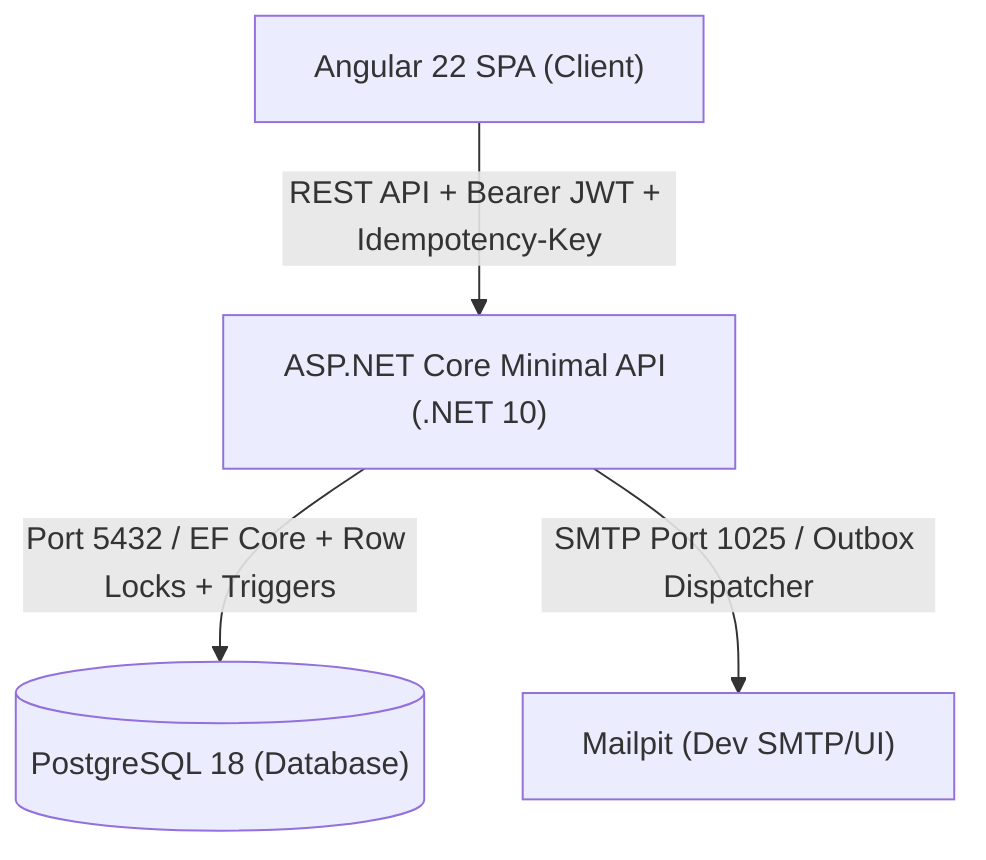

# Core Banking & Transaction Management System

A portfolio-grade, production-structured core banking and transaction management system designed to demonstrate **financial transaction integrity** (ACID guarantees, double-entry bookkeeping, database-level immutability triggers, idempotency, concurrency safety under contention, and auditable governance) behind a modern ASP.NET Core (.NET 10) Minimal API and an Angular 22 client.

---

## 🏛️ Architecture & System Overview



### 1. Core Banking & Double-Entry Ledger Engine (`backend/`)
- **Clean Architecture & Modular Monolith**: Implemented in .NET 10 (C# 14) with strict dependency boundaries:
  - `Bank.Domain`: Pure domain entities and value objects (no external dependencies).
  - `Bank.Application`: CQRS use-cases, validators, policies, and ports.
  - `Bank.Infrastructure`: EF Core, PostgreSQL persistence, Identity, Outbox, and email services.
  - `Bank.Api`: Minimal API endpoints, security middleware, filters, and composition root.
  - `Bank.Migrator`: Standalone migration runner executing SQL scripts and demo data seeding.
- **Financial Domain Aggregates**:
  - `Customer`, `Account`, `LedgerTransaction`, `LedgerEntry`.
  - Value objects: `Money` (fixed-precision BDT), `AccountNumber` (13-digit sequence with Luhn check digit), and `TransactionReference`.
- **Database-Enforced Immutability & Balance Triggers**:
  - `prevent_immutable_modification()`: Raises SQLSTATE `55000` on any attempted `UPDATE` or `DELETE` against `transactions`, `ledger_entries`, or `audit_logs` (`deploy/postgres/init-db.sh` & migration SQL).
  - `check_transaction_balanced()`: Deferred constraint trigger (`trg_ledger_entries_balanced`, ERRCODE `23514`) guaranteeing at commit time that each transaction contains lines $\ge 2$ and $\sum \text{debits} \equiv \sum \text{credits}$.
- **Concurrency & Deadlock-Free Money Movement**:
  - Pessimistic row-level locking (`SELECT ... FOR UPDATE ORDER BY id`) ensures deterministic locking order across cyclic account pairs, eliminating deadlocks (`40P01`) and avoiding lost updates.
- **Idempotency Engine**:
  - Requires `Idempotency-Key` on all mutating money endpoints (`/deposits`, `/withdrawals`, `/transfers`, `/reversals`).
  - Request body hashing (SHA-256) detects payload mismatches (`422 Unprocessable Entity`).
  - Concurrent in-flight requests return `409 Conflict`.
  - Completed operations return cached responses with header `Idempotent-Replayed: true`.
- **Reversals & Reconciliation**:
  - Admin reversals generate compensating entries linked via `reverses_transaction_id` with strict guards (`CANNOT_REVERSE_REVERSAL`).
  - Nightly / on-demand automated reconciliation jobs check stored account balances against summed ledger entries and report discrepancies.

---

### 2. Security & Compliance
- **ASP.NET Core Identity**: Secure password policy ($\ge 12$ characters, mixed class) and 5-attempt account lockout.
- **JWT & Refresh Token Rotation**:
  - Short-lived stateless JWT access tokens (15 minutes).
  - Single-use refresh tokens stored as cryptographic SHA-256 hashes.
  - **Family Reuse Detection**: If a previously consumed refresh token is presented, the entire family of tokens is revoked immediately.
- **Authorization & IDOR / BOLA Prevention**:
  - Resource-based authorization checks verify that the authenticated customer strictly owns the source account on debits, transfers, and transaction lookups.
- **Audit Logging**:
  - Append-only structured audit logs capturing actor, IP, timestamp, correlation ID, and before/after JSON states.
  - Hardened with security headers (CSP, HSTS, X-Frame-Options) and rate limiting.
- **Threat Model**: Documented under `docs/security/threat-model.md`.

---

### 3. Banking Web Application (`web/`)
- **Angular 22 Standalone SPA**: Signals-first state management styled with Tailwind CSS v4 and zoneless change detection.
- **Customer Portal**:
  - Self-registration, email verification via Mailpit, login, and token refresh.
  - Account opening wizard (Savings / Current).
  - Deposit, withdrawal, and transfer workflows with automatic client-side UUID idempotency key generation.
  - Transaction history with keyset (cursor-based) pagination and CSV statement export.
- **Admin Back-Office Portal**:
  - Customer directory and lifecycle control (suspension/reactivation).
  - Account freezing and unfreezing.
  - Transaction reversal dialog with required rationale.
  - Audit log viewer with before/after state diffs.
  - Reconciliation dashboard and discrepancy findings viewer.

---

### 4. DevOps & Deployment
- **Docker Compose Environment** (`docker-compose.yml`):
  - `postgres:18-alpine`: Database container with healthchecks and trigger setup.
  - `migrator`: Standalone runner applying schema migrations and seed data.
  - `api`: .NET 10 API running on port `8080`.
  - `web`: Angular 22 production build served via Nginx reverse proxy on port `80` (and `4200`).
  - `mailpit`: Dev SMTP server on port `1025` with web UI on port `8025`.
- **Continuous Integration**: GitHub Actions pipeline for build, formatting, test execution, and container scanning.

---

## 🌐 Port Mapping & Service URLs

When running the project via Docker Compose (`docker compose up`), the services are exposed on the following ports:

| Service | Host Port | Container Port | URL | Description |
|---|:---:|:---:|---|---|
| **Web Portal (Angular)** | `4200` & `80` | `80` | [http://localhost:4200](http://localhost:4200) | Customer & Admin Web Interface |
| **Backend API** | `8080` | `8080` | [http://localhost:8080](http://localhost:8080) | ASP.NET Core Minimal API |
| **Scalar API Docs** | `8080` | `8080` | [http://localhost:8080/scalar/v1](http://localhost:8080/scalar/v1) | Interactive modern API reference |
| **OpenAPI Spec** | `8080` | `8080` | [http://localhost:8080/openapi/v1.json](http://localhost:8080/openapi/v1.json) | Raw OpenAPI v3 JSON document |
| **Mailpit Web UI** | `8025` | `8025` | [http://localhost:8025](http://localhost:8025) | Email catcher UI (view verification emails) |
| **PostgreSQL 18** | `5432` | `5432` | `localhost:5432` | Database (`corebanking`, user: `bankuser`) |

> **Note on Port 8080:** In modern .NET (8, 9, 10), official Microsoft container images run as non-root by default. Ports below 1024 require elevated privileges in Linux containers, so Microsoft standardizes container HTTP listening to port **`8080`** (`ASPNETCORE_HTTP_PORTS=8080`).

---

## 📖 API Documentation: OpenAPI vs. Swagger vs. Scalar

### 1. OpenAPI Specification (The Standard)
* **What it is:** The vendor-neutral, machine-readable JSON/YAML standard describing REST endpoints, parameter schemas, request/response bodies, and authentication schemes.
* In .NET 10, ASP.NET Core natively generates the specification via `builder.Services.AddOpenApi()` and `app.MapOpenApi()`.
* **Path:** `http://localhost:8080/openapi/v1.json`

### 2. Swagger UI (The Legacy Visualizer)
* **What it is:** The traditional green-and-white web UI (`Swashbuckle.AspNetCore`) historically used to visualize OpenAPI specs.
* **Status:** Swashbuckle maintenance has slowed down in modern .NET; Microsoft now natively integrates OpenAPI and recommends modern alternatives like Scalar.

### 3. Scalar API Reference (The Modern Visualizer)
* **What it is:** A fast, beautifully designed open-source documentation interface that consumes the OpenAPI spec.
* **Features:** Built-in dark mode, interactive API testing ("Try it"), instant search, and automatic multi-language code snippets (cURL, C#, TypeScript, Python, etc.).
* **Path:** `http://localhost:8080/scalar/v1`

---

## 👥 Seeded Demo Credentials

The automated `migrator` initializes a rich dataset out of the box with 20 diverse customer profiles, multiple administrative back-office roles, compliance auditors, and complete double-entry transaction histories.

### Web Fast-Fill Demo Accounts (Password: `Pass12345678!`)
You can use the **Demo Fast Fill** buttons on the login page ([http://localhost:4200/auth/login](http://localhost:4200/auth/login)) or enter them manually:

| Role | Email | Password | Access Details |
|---|---|---|---|
| **Customer (Primary)** | `customer@apexbank.local` | `Pass12345678!` | Ayesha Siddiqua — Savings Account (`1010000010015`), pre-funded with BDT 85,000.00, Dhanmondi, Dhaka |
| **Admin (Primary)** | `admin@apexbank.local` | `Pass12345678!` | Full back-office management (customer freeze, reversals, audit logs, reconciliation) |
| **Auditor (Compliance)** | `auditor@apexbank.local` | `Pass12345678!` | Read-only compliance access to audit trails, ledger, and trial balance |
| **Admin (Supervisor)** | `supervisor@apexbank.local` | `Pass12345678!` | Operations supervisor back-office role |

### Seeded Bangladeshi Customers (Password: `Pass12345678!`)
| Customer | Account Number | Type | Starting Balance | Phone Number | City / Locality |
|---|---|---|---|---|---|
| **Ayesha Siddiqua** | `1010000010015` | Savings | BDT 85,000.00 | `+8801711001234` | Road 27, Dhanmondi, Dhaka |
| **Afroza Begum** | `1010000010023` | Savings | BDT 50,000.00 | `+8801712002345` | Gulshan-2, Dhaka |
| **Babul Mia** | `1010000010031` | Current (OD: 10,000) | BDT 35,000.00 | `+8801811003456` | Banani, Dhaka |
| **Md. Rafiqul Islam** | `1010000010049` / `1020000010212` | Savings & Current | BDT 145,000.00 & 30,000.00 | `+8801713004567` | Sector 7, Uttara, Dhaka |
| **Tanvir Ahmed** | `1010000010056` | Current (OD: 20,000) | BDT 65,000.00 | `+8801911005678` | Bashundhara R/A, Dhaka |
| **Jannatul Ferdous** | `1010000010064` | Savings | BDT 32,000.00 | `+8801819006789` | Mirpur DOHS, Dhaka |
| **Farhana Yasmin** | `1010000010072` | Current (OD: 25,000) | BDT 110,000.00 | `+8801300007890` | Agrabad C/A, Chittagong |
| **Kazi Mizanur Rahman** | `1010000010080` | Savings | BDT 78,000.00 | `+8801714008901` | Nasirabad, Chittagong |
| **Nusrat Jahan** | `1010000010098` | Savings | BDT 24,500.00 | `+8801912009012` | Zindabazar, Sylhet |
| **Saiful Alam** | `1010000010106` | Current (OD: 50,000) | BDT 180,000.00 | `+8801812001122` | Upashahar, Sylhet |
| **Fahmida Akter** | `1010000010114` | Savings | BDT 53,000.00 | `+8801715002233` | Shaheb Bazar, Rajshahi |
| **Kamal Hossain** | `1010000010122` | Current (OD: 20,000) | BDT 92,000.00 | `+8801400003344` | Kazir Dewri, Chittagong |
| **Mehedi Hasan** | `1010000010130` | Savings | BDT 125,000.00 | `+8801716004455` | Baridhara DOHS, Dhaka |
| **Shamim Hossain** | `1010000010148` | Current (OD: 15,000) | BDT 48,000.00 | `+8801813005566` | Motijheel C/A, Dhaka |
| **Rokeya Begum** | `1010000010155` | Savings | BDT 61,000.00 | `+8801552006677` | Khulshi R/A, Chittagong |
| **Mahfuzur Rahman** | `1010000010163` | Current (OD: 15,000) | BDT 74,000.00 | `+8801913007788` | Chawkbazar, Dhaka |
| **Tasnim Sultana** | `1010000010171` | Savings | BDT 105,000.00 | `+8801717008899` | Lalmatia, Dhaka |
| **Shakil Khan** | `1010000010189` | Current (OD: 10,000) | BDT 38,000.00 | `+8801814009900` | Shantinagar, Dhaka |
| **Sajjad Hossain** | `1010000010197` | Savings | BDT 160,000.00 | `+8801914001123` | Banani DOHS, Dhaka |
| **Nazmul Huda** | `1010000010205` | Savings | BDT 91,000.00 | `+8801718002234` | Sonadanga R/A, Khulna |

### Automated Test & CLI Accounts
| Role | Email | Password | Name / Profile |
|---|---|---|---|
| **Admin** | `admin@bank.local` | `Admin@Pass1234!` | Kazi Tariqul Islam (System Administrator) |
| **Auditor** | `auditor@bank.local` | `Auditor@Pass1234!` | Monirul Haque (Lead Auditor) |
| **Customer** | `afroza.begum@bank.local` | `Customer@Pass1234!` | Afroza Begum (Verified Savings Account) |
| **Customer** | `babul.mia@bank.local` | `Customer@Pass1234!` | Babul Mia (Verified Current Account) |

---

## 🚀 Getting Started Locally

### Prerequisites
- [Docker](https://docs.docker.com/get-docker/) & [Docker Compose](https://docs.docker.com/compose/)
- [.NET 10 SDK](https://dotnet.microsoft.com/download) (optional, for local CLI development)
- [Node.js 26+ & npm](https://nodejs.org/) (optional, for local frontend development)

### 1. Start the Complete Stack with Docker Compose
```bash
docker compose up --build
```
Once healthy:
1. Open [http://localhost:4200](http://localhost:4200) to access the banking application.
2. Sign in with the demo customer or admin credentials.
3. Open [http://localhost:8080/scalar/v1](http://localhost:8080/scalar/v1) to explore and execute API endpoints interactively.
4. Open [http://localhost:8025](http://localhost:8025) to view emails (verification tokens, notification alerts).

---

## 🧪 Testing & Verification

The project includes an exhaustive multi-level testing strategy:

```
backend/tests/
  ├── Bank.Domain.Tests/          # Unit tests (Money, AccountNumber, invariants)
  ├── Bank.Architecture.Tests/    # NetArchTest architectural boundary rules
  ├── Bank.Infrastructure.Tests/  # Real PostgreSQL Testcontainers integration tests
  └── Bank.Concurrency.Tests/     # 120-parallel transfer high-contention harness
web/
  └── src/**/*.spec.ts            # Angular frontend unit tests (Vitest)
```

### Run All Backend Tests (126 Tests)
```bash
dotnet test backend/Bank.sln
```

### Run Frontend Unit Tests (33 Tests)
```bash
cd web
npm test
```

### Test Suite Results Summary

| Test Category | Suite / Location | Tests Run | Result | Key Guarantees Proven |
|---|---|:---:|:---:|---|
| **Domain Unit Tests** | `Bank.Domain.Tests` | 70 | **PASS** | Money arithmetic, Luhn validation, transaction sign rules, overdraft limits. |
| **Property-Based Invariants** | `FsCheck` suites | 12 | **PASS** | 300 randomized sequences proving total balance conservation and $\sum \text{debits} \equiv \sum \text{credits}$. |
| **Architecture Boundaries** | `NetArchTest` | 3 | **PASS** | Clean Architecture enforcement; domain has zero outer dependencies. |
| **PostgreSQL Integration** | `Bank.Infrastructure.Tests` | 39 | **PASS** | Real PostgreSQL 18 in Testcontainers testing SQL immutability triggers, idempotency replays, and IDOR protection. |
| **High-Contention Concurrency** | `Bank.Concurrency.Tests` | 120 transfers | **PASS** | Cyclic account transfers: **0 deadlocks** (SQLSTATE `40P01`), **0 lost updates**, 100% completion rate. |
| **Frontend Unit Tests** | Angular / Vitest | 33 | **PASS** | Auth interceptors, idempotency interceptors, money pipes, and UI views. |
| **Total Automated Tests** | | **159 / 159** | **100% PASS** | Zero failures, zero skips, 0 compiler warnings. |

---

## 🔒 Security Threat Model & Protections

- **STRIDE Analysis**: Comprehensive threat matrix documented in [`docs/security/threat-model.md`](docs/security/threat-model.md).
- **Broken Object Level Authorization (BOLA/IDOR)**: Direct object references (account IDs, transaction IDs) are validated against the authenticated user's `CustomerId`.
- **Replay Protection**: Cryptographic token rotation and idempotency request caching prevent replay attacks and double debits.
- **Append-Only Immutability**: PostgreSQL triggers prevent SQL injection or compromised runtime accounts from modifying or deleting historical financial ledgers.
